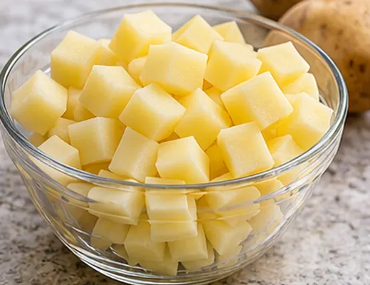
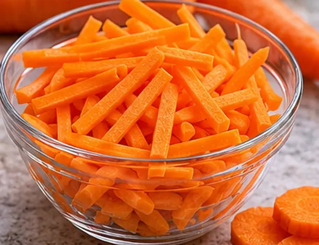
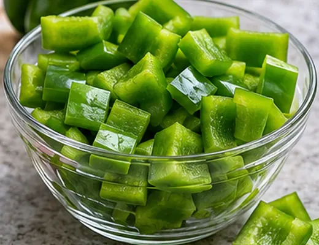
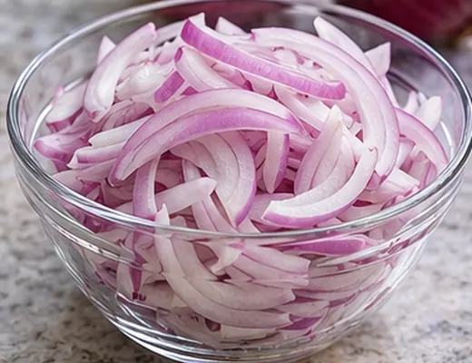
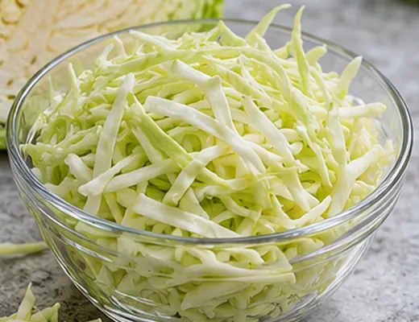
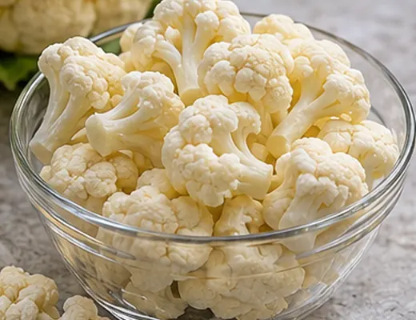
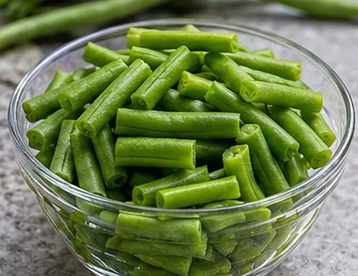
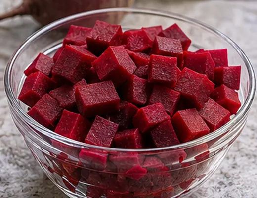

# FreshPrep — Eight AI-generated prepared-cut product images

**Image provenance:** All eight images are AI-generated, photorealistic *demo visuals*. They are **not photographs of FreshPrep's actual kitchen, packaging, sanitation procedures, inventory or measured samples**. They do not validate a precise physical cut tolerance. Replace them with verified production photographs before a customer-facing product approval.

**Repository directory:** `apps/web/public/images/prepared-cut/` (520 × 400 pixels, compressed WebP, approximately 22–33 KB each).

| Prepared vegetable (illustrative cut) | Demo image |
| --- | --- |
| Potato — diced 10 mm |  |
| Carrot — julienne 3 mm |  |
| Green capsicum — cubes 20 mm |  |
| Onion — sliced 3 mm |  |
| Cabbage — shredded 3 mm |  |
| Cauliflower — coarse chopped/florets, approximately 35 mm |  |
| French beans — cut approximately 30 mm |  |
| Beetroot — diced 10 mm |  |

## Integration

- The marketing homepage shows eight prepared-cut examples even when the demo API is not running.
- `apps/api/src/demo-catalog.ts` chooses a photo **only for the cut/size matching its appearance**. Other variants continue using generic illustrative images. The sample catalogue still contains 100 variants.
- The web frontend serves photos as same-origin static assets under `/images/prepared-cut/`, including in a Cloudflare Pages Vite build.
- The PostgreSQL demo seeder stores public HTTPS URLs pointing to an **immutable GitHub asset commit** (`c50a5c3`) so Expo Android can display them without needing web-domain configuration. GitHub-hosted images are adequate for a demo, not a long-term production CDN.
- The customer portal, mobile app and storefront identify the generated images as AI/demo illustrations.

## Updating an existing development database

The web local in-memory demo uses the latest seed on restart. An existing disposable PostgreSQL **development** database needs explicit reseeding to apply the new demo SKU image URLs and adjusted sample cut sizes:

```bash
# Never run this on a production database.
FRESHPREP_DEMO_DB_SEED=YES_I_WANT_SAMPLE_DATA npm run db:seed-demo --workspace @freshprep/api
```

For Windows PowerShell, set `$env:FRESHPREP_DEMO_DB_SEED='YES_I_WANT_SAMPLE_DATA'`, point `DATABASE_URL` to a disposable database, and run the same command. The seeder deliberately refuses to run when `NODE_ENV=production`.

**No live deployment, production catalogue update, photography provenance verification or customer approval is implied.** Replace demo images with actual images from the preparation floor, reviewed and approved by the food business, before public launch.
