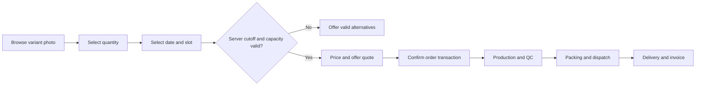
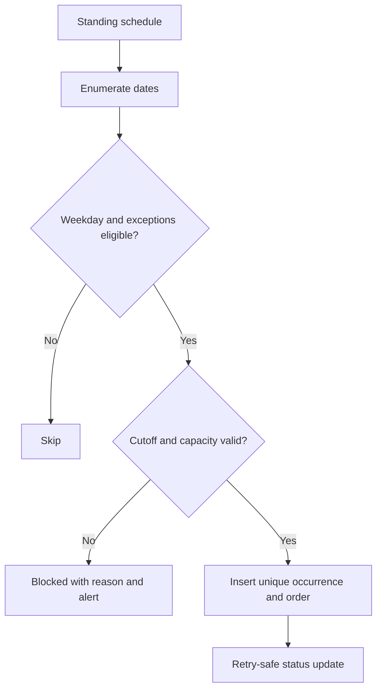
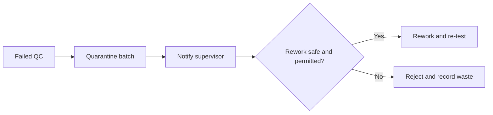

# FreshPrep Veggies — Software Requirements Specification v3

**Status:** implementation specification baseline (not yet fully built). **Stack:** TypeScript; Node.js/Hono API; React/Vite admin; Expo/React Native customer app; PostgreSQL/Drizzle; low-cost/free-tier-first hosting.

## 1. Services and architecture
Modular monorepo with `apps/api`, `apps/admin`, `apps/customer`, `packages/domain`, `packages/validation`, and `packages/ui` as practical. REST JSON API version `/api/v1`; OpenAPI specification and shared Zod validators. All time-domain logic uses **Asia/Kolkata**, persisted timestamps in UTC and business delivery local dates separately. Production requires persistent database, migrations, robust server-side authorization and transactional invariants.

## 2. Entity/table inventory (logical schema)
- `organizations`, `users`, `organization_members`, `roles`, `permissions`, `role_permissions`, `user_sessions`, `audit_events`
- `customer_accounts`, `kitchens`, `addresses`, `delivery_zones`, `customer_contracts`, `contract_price_rules`
- `vegetables`, `preparation_methods`, `size_definitions`, `product_variants`, `variant_images`, `variant_price_history`, `variant_processing_instructions`
- `delivery_slots`, `slot_zone_rules`, `slot_blackouts`, `slot_capacity_reservations`
- `carts`, `cart_items`, `orders`, `order_items`, `order_status_events`, `order_idempotency_keys`
- `recurring_schedules`, `recurring_schedule_items`, `recurring_occurrences`, `schedule_exceptions`
- `suppliers`, `purchases`, `purchase_lines`, `raw_material_lots`, `inventory_movements`
- `production_plans`, `work_orders`, `processing_batches`, `batch_inputs`, `batch_outputs`, `qc_checks`, `pack_units`, `batch_trace_links`
- `delivery_runs`, `delivery_stops`, `delivery_assignments`, `proof_of_delivery`, `returns`, `complaints`
- `invoices`, `invoice_lines`, `credit_notes`, `payments`, `payment_allocations`
- `hero_slides`, `announcements`, `campaigns`, `offer_rules`, `coupon_codes`, `coupon_redemptions`, `loyalty_accounts`, `loyalty_ledger`, `notification_events`, `notification_preferences`

All tenant-owned data includes tenant/customer identity, timestamps, and necessary ownership constraints. Use unique constraints for SKU and (schedule_id, occurrence_date, slot_id). Add indexes on order statuses, delivery date/slot, customer_id, variant_id, active campaign validity, and lot traceability.

## 3. Variant model and validation
`product_variants` fields: id, vegetable_id, preparation_method_id, size_definition_id, SKU, label, description, active, sell_unit, min_quantity_grams, increment_grams, tolerance_mm, lead_minutes, price eligibility, expected_yield_pct. `size_definitions` includes `measurement_kind` (numeric/label), `value`, `unit` (mm/cm or enum fine/medium/coarse/thin/thick), dimension/axis meaning and admin display order. Same vegetable + method may contain any number of sizes. Return image(s) and authoritative price per variant. Prevent duplicate active SKU and invalid dimension (<=0), enforce minimum and increments.

## 4. Slot cutoff algorithm
Delivery slot: `start_minute`, `end_minute`, `cutoff_day_offset` (0 same day, 1 prior day), `cutoff_minute`, timezone, service zone, capacities and blackout rules. `cutoff_at = local_delivery_date - cutoff_day_offset days + cutoff_time` in Asia/Kolkata, converted to UTC. Bookable only if `now < cutoff_at`, within service zone and capacity, active/not blacked out. Re-evaluate and reserve capacity transactionally at checkout; reject stale client availability. Example: Mon 05:00–08:00 deadline Sun 23:00, Mon 14:00–17:00 deadline Mon 11:00. Day boundary/timezone tests required. Overlapping slots need explicit admin prevention or independently tracked resources.

## 5. Recurrence engine
`frequency=DAILY|WEEKLY`; weekly has nonempty subset weekdays 0..6, start/end date, preferred slot, kitchen, exact variant basket and future pricing policy. Scheduler enumerates eligible dates in bounded horizon, applies holidays/skips/pauses, validates cutoff/capacity, generates one `recurring_occurrence` per (schedule,date,slot) with deterministic idempotency and transactional order creation. Retry without duplicating orders. If insufficient stock or expired slot, mark occurrence `BLOCKED` and notify operator/customer; never silently create promised orders. Cancellation/amendment after cutoff requires supervised exception. Freeze accepted order's unit prices, tax, discount and point redemption.

## 6. APIs (indicative)
| Group | Routes / operations |
|---|---|
| Identity | `POST /auth/login`, `POST /auth/logout`, `GET /me`, `GET/PUT /me/preferences` |
| Tenancy | `GET/POST /customers`, `GET/POST /customers/:id/kitchens`, `GET/POST /addresses` |
| Roles | `GET /roles`, `POST /roles`, `PATCH /roles/:id`, `GET/PUT /roles/:id/permissions` |
| Catalogue | `GET /catalog/vegetables`, `GET /catalog/variants`, `GET /catalog/variants/:id`, `POST/PATCH /admin/variants`, `POST /admin/variant-images` |
| Availability | `GET /delivery/slots?date=&addressId=`, `POST /admin/delivery-slots`, `PATCH /admin/delivery-slots/:id`, `POST /admin/blackouts` |
| Orders | `GET/PUT /cart`, `POST /orders/quote`, `POST /orders`, `GET /orders/:id`, `POST /orders/:id/cancel` |
| Recurrence | `GET/POST /recurrences`, `PATCH /recurrences/:id`, `POST /recurrences/:id/pause`, `POST /recurrences/:id/resume`, `POST /recurrences/:id/skip`, `GET /recurrences/:id/occurrences` |
| Procurement | `GET/POST /purchases`, `POST /purchases/:id/receive`, `GET /inventory/lots` |
| Production/QC | `GET/POST /work-orders`, `POST /batches/:id/complete`, `POST /batches/:id/qc`, `POST /packing/units` |
| Delivery | `GET/POST /delivery-runs`, `POST /delivery-stops/:id/status`, `POST /delivery-stops/:id/pod` |
| Finance | `GET /invoices`, `GET /payments`, `POST /payments/record`, `POST /credit-notes` |
| Marketing | `GET /home/content`, `GET/POST/PATCH /admin/hero-slides`, `GET/POST/PATCH /admin/announcements`, `GET/POST/PATCH /admin/campaigns`, `POST /offers/validate` |
| Loyalty | `GET /loyalty/balance`, `GET /loyalty/ledger`, `POST /loyalty/preview-redemption`, `POST /admin/loyalty/adjustments` |
| Reporting | `GET /reports/orders`, `GET /reports/yield`, `GET /reports/delivery`, `GET /reports/promotions`, `GET /reports/loyalty` |

All mutating routes require server authentication, resource ownership check, permission check, validated input, audit where applicable, and idempotency for monetary/order creation mutations. No access token in query strings. No customer may read another customer's kitchen, order, ledger or contract.

## 7. Screen requirements
**Customer:** splash/login; company/kitchen switcher; home slider/announcement/offer tiles; browse by vegetable/preparation/size with actual variant photos; filters/search; product detail; cart; available slots/cutoff reason; checkout/offer/points; order tracker/history; recurring schedule create/edit/calendar/pause/skip; invoices/payments; loyalty wallet/ledger; profile/addresses/support.

**Admin/operator:** login/dashboard with sales, orders, production load, shortages and delivery KPIs; vegetable/preparation/size/variant CRUD; image library; variant pricing and effective dates; customer/accounts/contracts; slot/cutoff/capacity/zone calendar; standing-order monitoring; purchase & lot receiving; production queues; batch measurement/QC; pack labels; route planning/POD; returns; invoice/receivables; slider and announcement CMS; coupon and offer rule editor; loyalty policy/ledger; reports/charts; role matrix; audit log; exception queue.

## 8. Core workflows

## 9. Permissions
Roles: superadmin, operations admin, sales, procurement, store, production operator, QC, packer, dispatcher, driver, finance, customer admin, customer buyer, customer viewer. Permission format `resource:action` (view/create/edit/approve/adjust/delete/export). Examples: only admin approves cutoffs; only QC approves/rejects batches; driver only sees assigned routes; finance authorizes credit adjustments; marketing role authors slides but publisher approval can be separate. Enforce in API, never solely hide UI.

## 10. Order, price, promotion and loyalty invariants
- Accepted order prices/discounts frozen; future recurring occurrences priced at scheduled quote time using effective dated rules.
- Offers apply only to eligible customers/variants/quantity/date; exclusive stacking, redemptions and quotas enforced transactionally.
- Points ledger stores immutable events (EARN, REDEEM, EXPIRE, REVERSE, ADJUST) and references source transaction; negative balances prohibited unless explicitly authorized policy.
- Earn points after qualified fulfilment and settlement; refunds reverse earned points and restore redemptions where policy demands.
- Order statuses: DRAFT → CONFIRMED → IN_PRODUCTION → QC_PASSED → PACKED → DISPATCHED → DELIVERED, plus approved CANCELLED/REJECTED/EXCEPTION transitions.
- Raw and finished stock tracked by immutable movements, reconciled weights and lot links.

## 11. Test/UAT baseline (minimum)
| ID | Scenario | Expected |
|---|---|---|
| UAT-01 | Potato diced 10 mm versus 20 mm | Distinct cards, images, SKUs, prices and work instructions |
| UAT-02 | Carrot grated fine/medium/coarse | All independent, selectable variants |
| UAT-03 | Quantity below minimum or wrong increment | Server rejects |
| UAT-04 | Monday 05:00 slot at Sunday 22:59 IST | Permitted when capacity/zone valid |
| UAT-05 | Same slot at Sunday 23:00 IST | Rejected exactly at cutoff |
| UAT-06 | 14:00 slot at same-day 11:00 IST | Rejected |
| UAT-07 | Two simultaneous final-slot checkouts | No oversell; one or both rejected per capacity |
| UAT-08 | M/W/F recurrence generation for two weeks | Only matching dates |
| UAT-09 | Retry scheduler | No duplicate occurrence or order |
| UAT-10 | Skip next Wednesday | Only specified date excluded |
| UAT-11 | Change price after confirmation | Existing order unchanged |
| UAT-12 | Expired/paused hero banner | Not shown |
| UAT-13 | Coupon quota exhausted concurrently | No excess redemption |
| UAT-14 | Refund of points-earned order | Reversal posted once |
| UAT-15 | Customer A requests Customer B invoice | Forbidden |
| UAT-16 | QC failure on batch | Quarantined and cannot dispatch |
| UAT-17 | Delivery shortage and customer complaint | Traceable adjustment/credit flow |
| UAT-18 | Zone holiday and cut-off exception | Proper blocked status and audit |
| UAT-19 | Admin changes size/slot after orders | Past snapshots preserved |
| UAT-20 | Restore database backup | Verified recovery and integrity |

Add API unit, integration, property, concurrency, security and end-to-end tests for negative cases and permissions.

## 12. Quality gates and deployment
Measured tests and coverage; TypeScript strict compilation; schema migration rehearsals; no unauthenticated /dev production endpoints; secrets out of git; rate limits, structured logs with privacy controls, storage quotas, access reviews, recovery and rollback plan. Avoid unnecessary CI workflows and cost-bearing services. Cloudflare/host-specific quotas need validation before release.

## 13. Unresolved policy items
Product dimension tolerance; cut/weight rounding; expiry/handling rules; customer-specific rate precedence; promotion stacking; loyalty earning and expiry; recurrence horizon; after-cutoff amendments; slot capacity units; payment/credit rules; approved invoices and GST handling; language support; exact launch zones and packaging choices.
