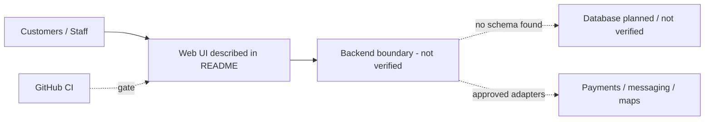
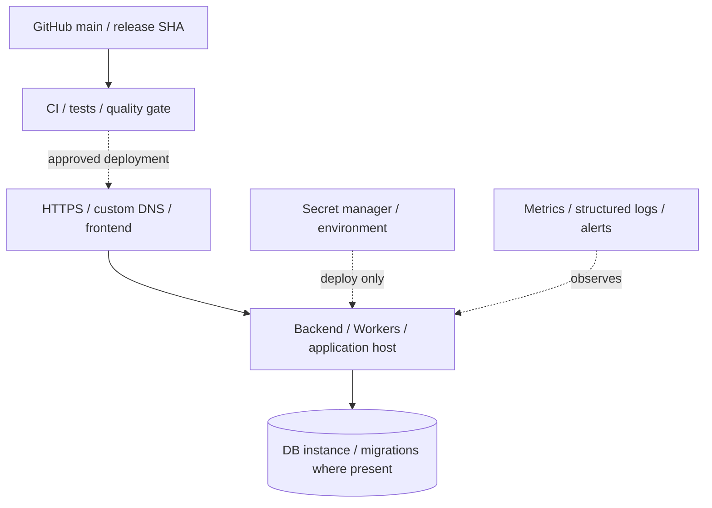
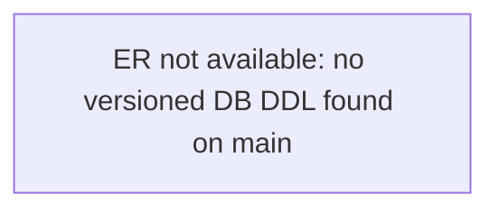

# FreshPrep Veggies: Architecture, Deployment, ER, DB, Migration and KT
> **Snapshot:** 2026-11-09. Evidence: [bv-prasanna/cut-vegetables](https://github.com/bv-prasanna/cut-vegetables) default branch `main`. This is **source-derived**, not a live deployment or data audit.
**Repository limitation:** default-branch tree has no authoritative application schema or deployable backend. The README may describe planned/other-branch components. Do not mistake this logical diagram for code verification.
## 1. Application architecture
**Stack:** README describes Node/TypeScript, Hono, React, PostgreSQL and Expo, but main has README only.

**Security/data flow:** browser/app -> validated API -> RBAC/session/tenant checks -> transaction/domain service -> database -> auditable external integration; server verifies provider webhooks and preserves idempotency. In projects lacking source on main, this is the **expected** flow, not code proof.

## 2. Deployment topology (reference only)

**Deployment inventory to complete:** DEV/UAT/PROD; Git SHA; frontend host; API runtime, URL and region; DB provider and backup policy; CORS/TLS; payment webhook URLs; service accounts; mail/SMS provider; Android signing; rollback owner; support contacts and alert routing. This schematic does not confirm any particular hosting account is active.

## 3. ER diagram - observed baseline only
No verifiable default-branch DDL was found. The following is an evidence-gap marker, not a fabricated entity model.

**Schema status:** unverified; do not generate production migration scripts by guessing entities.

## 4. Database schema and migration catalogue
- Migration files discovered on `main`: **0**.
- Definitive source SQL sequence:
  - None. Seek the app/backend feature branch, migration repository or deployed schema-only export.
- **Full database schema** must be extracted from the actual environment: PostgreSQL `pg_dump --schema-only --no-owner --no-privileges` (then inspect `flyway_schema_history`), or Cloudflare D1 `SELECT type,name,tbl_name,sql FROM sqlite_master WHERE type IN ('table','view','index')` on the verified binding.
- Record columns, PK/FK/unique/check constraints, indexes, triggers, views, migration versions and applied checksums; compare results with this repository's migrations.

## 5. Guarded migration procedure and reusable script
**Migration mechanism:** Migration source NOT found on this default branch; cannot supply verified migration command. Existing checked-in migrations must not be modified or replaced just to make documentation pass.
```bash
#!/usr/bin/env bash
set -euo pipefail
if [[ "${1:-plan}" != "apply" ]]; then
  echo "PLAN: compare environment, DB identity, migrations/checksums and release SHA."
  echo "Back up, restore-test and execute on staging; this mode changes NOTHING."
  exit 0
fi
[[ "${CONFIRM_DB_MIGRATION:-}" == "BACKUP_VERIFIED" ]] || exit 3
: "${BACKUP_REFERENCE:?Required tested backup/snapshot reference}"
: "${MIGRATION_APPLY_CMD:?Required reviewed, repo-native migration command}"
bash -lc "$MIGRATION_APPLY_CMD"
echo "Check schema history, health, rollback compatibility, audit and business smoke."
```
**Release SOP:** verify instance/environment; migration diff review; secure secrets; backup/restore rehearsal; staging apply and UAT; one approved production apply; inspect schema history/logs; smoke auth/main flow/notifications/payments; record deployed SHA; rollback compatible binary or use tested forward fix/restore. Never execute placeholder SQL against production.

## 6. Maintenance runbook
**Daily:** user experience, 5xx, health, sessions, email/SMS or provider errors, failed jobs, DB availability and storage. **Weekly:** migration drift, restore sample, backups, reconciliation/refund exceptions if applicable, CI build and key expiry. **Monthly:** dependency and authorization review, logs/privacy retention, cert/domain renewal, architecture drift and disaster recovery exercise.
**Incidents:** capture request/correlation ID and last-good SHA; preserve evidence; contain failures; decide rollback/restore with owner; validate data integrity and write RCA. No access tokens or PII in tickets/demo materials.

## 7. KT and UAT demo agenda
**Scenario:** B2B product/size -> recurring order and delivery window -> cutter/packing -> dispatch.
| Segment | Demonstrate |
|---|---|
| 0-10 min | Business objectives, actor roles, in-scope deployment maturity |
| 10-25 min | Main user/admin/ops journey and friendly success/error states |
| 25-40 min | Service diagram, ER limitations, API auth, data ownership and integrations |
| 40-50 min | Build/CI, environment setup, migration/rollback procedures |
| 50-60 min | Monitoring, backups, on-call, issue triage and handover sign-off |

**Negative-case checklist:** bad/expired login, role violation, invalid payload, duplicate or concurrent request, offline/timeout, retries, payment webhook replay, refund failure, DB outage, missing GPS where required, premature release and schema checksum mismatch. Test only functionality that exists in the selected release.

## 8. KT acceptance and outstanding evidence
- [ ] Actual deployed SHA, service DNS, hosting plan and cloud account recorded privately
- [ ] Verified schema-only export and **complete** ER delivered, reviewed by DB owner
- [ ] Migration tracking, pre/post backup, restored sample and rollback rehearsal completed
- [ ] Source/build/CI test evidence, operational walkthrough and negative tests signed
- [ ] Alert dashboards, log access, incident owners, TLS, credentials transferred securely
- [ ] Open UAT issues, regulatory/production gates and next work items acknowledged

## 9. Related repo material
- No workflow found on this branch.


*Next update: reconcile against complete source branch and actual deployed schema; source file presence does not prove a production rollout, CI success or functional coverage.*
