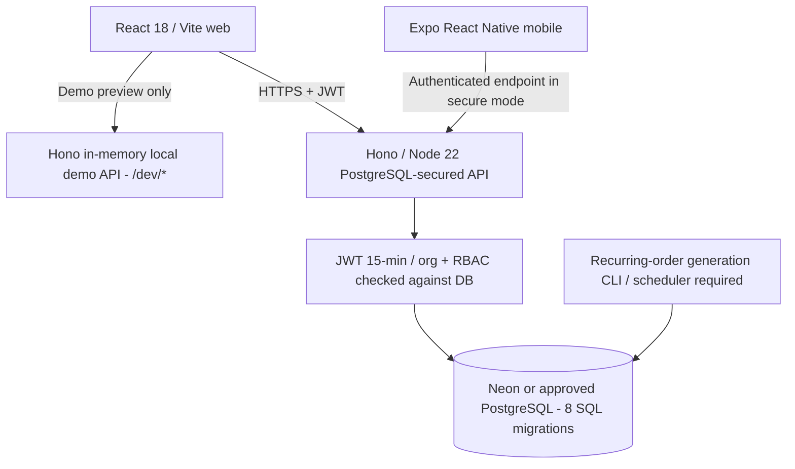
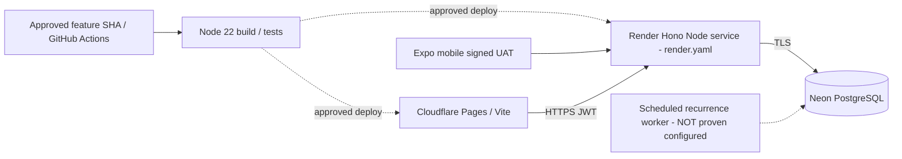

# FreshPrep: verified-source architecture, API, deployment and KT map

> Reverse-engineering completed 10 Nov 2026 from [`feat/typescript-platform-foundation` (`a4ebfc20329e`)](https://github.com/bv-prasanna/cut-vegetables/tree/a4ebfc20329e2461044497063ab55a91ff8051b9). **The default `main` does not have these apps or migrations; this is not evidence of a live production release.**

## Architecture — two distinct API modes

**Do not confuse** `apps/api/src/app.ts` (local demo and deliberately unprotected `/dev/*` endpoints) with `apps/api/src/production-app.ts` (PostgreSQL-backed JWT and role-scoped APIs). [Source](https://github.com/bv-prasanna/cut-vegetables/blob/a4ebfc20329e2461044497063ab55a91ff8051b9/apps/api/src/production-app.ts).

## Reference deployment, NOT verified live

[Render blueprint](https://github.com/bv-prasanna/cut-vegetables/blob/a4ebfc20329e2461044497063ab55a91ff8051b9/render.yaml) specifies Node 22, Singapore free plan, branch `feat/typescript-platform-foundation`, `npm run api:prod`, health route `/health`, and secret placeholders `DATABASE_URL`, `JWT_SECRET`, `ALLOWED_ORIGINS`. This is **configuration**, not proof a Render service exists or is healthy.

## Actual Hono route declarations (code-inspected)

These declarations were extracted from concrete handler files; `createProductionApp` mounts several route modules under `/v1`. For module-declared routes, prepend `/v1` when called through the production API. The dev API is a separate process and **never production public**.

### production: [`apps/api/src/production-app.ts`](https://github.com/bv-prasanna/cut-vegetables/blob/a4ebfc20329e2461044497063ab55a91ff8051b9/apps/api/src/production-app.ts)

| Method | Declaration |
|---|---|
| `GET` | `/health` |
| `POST` | `/auth/login` |
| `POST` | `/v1/logout` |
| `GET` | `/v1/me` |
| `GET` | `/v1/catalog` |
| `GET` | `/v1/orders` |
| `POST` | `/v1/orders` |

### admin: [`apps/api/src/admin-routes.ts`](https://github.com/bv-prasanna/cut-vegetables/blob/a4ebfc20329e2461044497063ab55a91ff8051b9/apps/api/src/admin-routes.ts)

| Method | Declaration |
|---|---|
| `GET` | `/admin/roles` |
| `GET` | `/admin/staff` |
| `POST` | `/admin/staff` |
| `GET` | `/admin/customers` |
| `POST` | `/admin/customers` |
| `GET` | `/admin/overview` |
| `GET` | `/admin/insights` |
| `GET` | `/delivery-slots` |
| `GET` | `/kitchens` |

### operations: [`apps/api/src/ops-routes.ts`](https://github.com/bv-prasanna/cut-vegetables/blob/a4ebfc20329e2461044497063ab55a91ff8051b9/apps/api/src/ops-routes.ts)

| Method | Declaration |
|---|---|
| `GET` | `/ops/suppliers` |
| `GET` | `/ops/purchases` |
| `GET` | `/ops/raw-lots` |
| `GET` | `/ops/stops` |
| `GET` | `/ops/summary` |
| `GET` | `/ops/orders` |
| `GET` | `/ops/batches` |
| `GET` | `/ops/runs` |
| `GET` | `/ops/audit` |
| `POST` | `/ops/suppliers` |
| `POST` | `/ops/purchases` |
| `POST` | `/ops/purchases/:id/receive` |
| `POST` | `/ops/batches` |
| `POST` | `/ops/batches/:id/complete` |
| `POST` | `/ops/batches/:id/qc` |
| `POST` | `/ops/batches/:id/pack` |
| `POST` | `/ops/runs` |
| `POST` | `/ops/runs/:id/stops` |
| `POST` | `/ops/stops/:id/complete` |

### recurrence: [`apps/api/src/recurrence-routes.ts`](https://github.com/bv-prasanna/cut-vegetables/blob/a4ebfc20329e2461044497063ab55a91ff8051b9/apps/api/src/recurrence-routes.ts)

| Method | Declaration |
|---|---|
| `GET` | `/admin/recurrences` |
| `GET` | `/recurrences` |
| `POST` | `/recurrences` |
| `PATCH` | `/recurrences/:id` |
| `POST` | `/recurrences/:id/skips` |
| `POST` | `/admin/recurrences/generate` |

### staff: [`apps/api/src/staff-query-routes.ts`](https://github.com/bv-prasanna/cut-vegetables/blob/a4ebfc20329e2461044497063ab55a91ff8051b9/apps/api/src/staff-query-routes.ts)

| Method | Declaration |
|---|---|
| `GET` | `/ops/production-plan` |
| `GET` | `/ops/packing-board` |
| `GET` | `/ops/delivery-board` |

### local-dev: [`apps/api/src/app.ts`](https://github.com/bv-prasanna/cut-vegetables/blob/a4ebfc20329e2461044497063ab55a91ff8051b9/apps/api/src/app.ts)

| Method | Declaration |
|---|---|
| `GET` | `/dev/admin/events` |
| `GET` | `/catalog/demo-info` |
| `GET` | `/dev/admin/dashboard` |
| `GET` | `/dev/admin/roles` |
| `GET` | `/dev/staff/production` |
| `GET` | `/dev/staff/packing` |
| `GET` | `/dev/staff/delivery` |
| `POST` | `/dev/staff/orders/:id/advance` |
| `PATCH` | `/dev/admin/orders/:id/state` |
| `GET` | `/home/slides` |
| `GET` | `/home/announcements` |
| `GET` | `/dev/admin/slides` |
| `POST` | `/dev/admin/slides` |
| `DELETE` | `/dev/admin/slides/:id` |
| `GET` | `/dev/admin/announcements` |
| `POST` | `/dev/admin/announcements` |
| `DELETE` | `/dev/admin/announcements/:id` |
| `GET` | `/health` |
| `GET` | `/catalog/variants` |
| `GET` | `/delivery/slots` |
| `POST` | `/dev/admin/variants` |
| `POST` | `/dev/admin/slots` |
| `POST` | `/dev/recurrences` |
| `GET` | `/dev/recurrences` |
| `GET` | `/dev/recurrences/:id/dates` |
| `GET` | `/dev/orders` |
| `POST` | `/dev/orders` |
| `GET` | `/delivery/slots/:id/availability` |

**Path caution:** For group routes, code composition determines full URI. This list is source declarations rather than a runtime-tested OpenAPI export.

## Business data model
[Full migration-backed PostgreSQL schema and ER](https://github.com/bv-prasanna/cut-vegetables/blob/main/docs/architecture-kt/SCHEMA_INDEX.md) was recovered from the eight migration files in this feature SHA: **36 CREATE TABLE statements** and **56 raw REFERENCES occurrences**. Key source areas include organizations/memberships, kitchens, vegetables/preparations/variants, slot cutoff/capacity, one-off and recurring orders, inventory/procurement, production/yield/QC, packing, delivery runs/assigned driver proof, and audit/geographic events. Table constraints and tenant-scoped SQL are the ultimate source of truth.

## Web screens found in source (11)
- [`apps/web/src/AdminDashboard.tsx`](https://github.com/bv-prasanna/cut-vegetables/blob/a4ebfc20329e2461044497063ab55a91ff8051b9/apps/web/src/AdminDashboard.tsx)
- [`apps/web/src/AdminInsights.tsx`](https://github.com/bv-prasanna/cut-vegetables/blob/a4ebfc20329e2461044497063ab55a91ff8051b9/apps/web/src/AdminInsights.tsx)
- [`apps/web/src/CatalogAdmin.tsx`](https://github.com/bv-prasanna/cut-vegetables/blob/a4ebfc20329e2461044497063ab55a91ff8051b9/apps/web/src/CatalogAdmin.tsx)
- [`apps/web/src/CustomerOrderPortal.tsx`](https://github.com/bv-prasanna/cut-vegetables/blob/a4ebfc20329e2461044497063ab55a91ff8051b9/apps/web/src/CustomerOrderPortal.tsx)
- [`apps/web/src/MarketingAdmin.tsx`](https://github.com/bv-prasanna/cut-vegetables/blob/a4ebfc20329e2461044497063ab55a91ff8051b9/apps/web/src/MarketingAdmin.tsx)
- [`apps/web/src/MarketingHome.test.tsx`](https://github.com/bv-prasanna/cut-vegetables/blob/a4ebfc20329e2461044497063ab55a91ff8051b9/apps/web/src/MarketingHome.test.tsx)
- [`apps/web/src/MarketingHome.tsx`](https://github.com/bv-prasanna/cut-vegetables/blob/a4ebfc20329e2461044497063ab55a91ff8051b9/apps/web/src/MarketingHome.tsx)
- [`apps/web/src/SecurePortal.tsx`](https://github.com/bv-prasanna/cut-vegetables/blob/a4ebfc20329e2461044497063ab55a91ff8051b9/apps/web/src/SecurePortal.tsx)
- [`apps/web/src/StaffBoards.test.tsx`](https://github.com/bv-prasanna/cut-vegetables/blob/a4ebfc20329e2461044497063ab55a91ff8051b9/apps/web/src/StaffBoards.test.tsx)
- [`apps/web/src/StaffBoards.tsx`](https://github.com/bv-prasanna/cut-vegetables/blob/a4ebfc20329e2461044497063ab55a91ff8051b9/apps/web/src/StaffBoards.tsx)
- [`apps/web/src/main.tsx`](https://github.com/bv-prasanna/cut-vegetables/blob/a4ebfc20329e2461044497063ab55a91ff8051b9/apps/web/src/main.tsx)

## Expo mobile views (3)
- [`apps/mobile/src/SecureApp.tsx`](https://github.com/bv-prasanna/cut-vegetables/blob/a4ebfc20329e2461044497063ab55a91ff8051b9/apps/mobile/src/SecureApp.tsx)
- [`apps/mobile/src/StaffWorkBoard.tsx`](https://github.com/bv-prasanna/cut-vegetables/blob/a4ebfc20329e2461044497063ab55a91ff8051b9/apps/mobile/src/StaffWorkBoard.tsx)
- [`apps/mobile/src/WorkQueueCards.tsx`](https://github.com/bv-prasanna/cut-vegetables/blob/a4ebfc20329e2461044497063ab55a91ff8051b9/apps/mobile/src/WorkQueueCards.tsx)

## Build and migration commands
**Root npm package scripts:** `npm run verify:local`, `npm run check`, `npm run dev`, `npm run api:prod`, `npm run web:build` (Node 22+). Mobile is a **separate** `apps/mobile` project outside root workspaces for React Native dependency isolation.

**Backend:** from `apps/api`, `npm run db:migrate` and `npm run db:bootstrap` on an **approved dedicated staging PostgreSQL URL** only after backup and access validation. `npm run start:pg` serves secure API; `npm run recurrence:run` is the manual recurrence worker. Provider scheduler automation is not verified. [DB setup](https://github.com/bv-prasanna/cut-vegetables/blob/a4ebfc20329e2461044497063ab55a91ff8051b9/docs/DB_SETUP.md).

**Known configuration:** `DATABASE_URL`, `JWT_SECRET` (32+ random bytes), `ALLOWED_ORIGINS`, bootstrap identity variables; never put secrets in Pages/Vite public variables. [JWT/deployment reference](https://github.com/bv-prasanna/cut-vegetables/blob/a4ebfc20329e2461044497063ab55a91ff8051b9/docs/JWT_DEPLOYMENT.md).

## Quality and KT
**Test source files found:** 30. [Automated UAT evidence and visual audit](https://github.com/bv-prasanna/cut-vegetables/blob/a4ebfc20329e2461044497063ab55a91ff8051b9/docs/UAT_AUDIT_2026-11.md); [release readiness](https://github.com/bv-prasanna/cut-vegetables/blob/a4ebfc20329e2461044497063ab55a91ff8051b9/docs/RELEASE_READINESS.md). Source docs report CI coverage of PostgreSQL integration, role guards, order/recurrence, production/QC/packing/delivery. **No live build or CI status was executed in this documentation pass**.

| KT topic | Suggested demonstrated flow |
|---|---|
| Customer | Authenticate, list cut variants, add weights, kitchen/date/slot, place one-off order, create and pause recurrence |
| Admin | Superadmin CLI bootstrap, staff roles/permissions, customers/kitchens, products, delivery slots, analytics |
| Operator | Supplier and purchase, raw lot receipt, batch cutting/yield, QC pass/fail, pack labels, dispatch and assigned driver POD |
| Security | Wrong credentials, 401/403, 8-failure login throttling, expired JWT, double-submit/idempotency, org-scoping, location permission |
| Deployment/DBA | Migrations 0001–0008, checksum lock, backup and restore, tested signed APK and release rollback |

## Concrete incomplete gates (not certified)
- Feature branch has not been merged to `main`; no confirmed live staging, signed APK device UAT, photo/brand acceptance, accessibility signoff or production backup/restore verification.
- No continuously reliable recurring-order scheduler is proven configured; sleeping free services can miss deadlines.
- Finance/GST/credit/payment invoicing, promotions/loyalty, password reset/invitations/MFA and some production-floor input controls remain open per [release audit](https://github.com/bv-prasanna/cut-vegetables/blob/a4ebfc20329e2461044497063ab55a91ff8051b9/docs/RELEASE_READINESS.md).
- Demo images, fake prices and unprotected local `/dev` routes must not be used as customer/production data.
- Historical `apps/mobile/README.md` describes a demo-role switcher; compare against current `SecureApp.tsx` and secure role client for the reviewed release, do not assume a role-switcher is authentication.

**Code reviewed, production not certified.** Obtain release SHA, passing CI, correct cloud/DB environment, on-device UAT, restore proof, deployment smoke, privacy/payment approval and customer signoff before go-live.