# FreshPrep — reverse-engineered PostgreSQL schema (feature branch)

**Verified source:** [`bv-prasanna/cut-vegetables`, branch `feat/typescript-platform-foundation` at `a4ebfc20329e2461044497063ab55a91ff8051b9`](https://github.com/bv-prasanna/cut-vegetables/tree/a4ebfc20329e2461044497063ab55a91ff8051b9). **Generated:** 10 Nov 2026. The `main` branch does not contain these migration SQL files. This is NOT a statement that they have been merged or deployed.

## Database metadata
- Engine: PostgreSQL, source migration files: **8** (`db/migrations/0001_* ... 0008_*`).
- Tables detected by `CREATE TABLE`: **36**; explicit SQL `REFERENCES` declarations parsed: **56**.
- SQL runner code: [`apps/api/src/db-migrate.ts`](https://github.com/bv-prasanna/cut-vegetables/blob/a4ebfc20329e2461044497063ab55a91ff8051b9/apps/api/src/db-migrate.ts). Repo documentation states it uses SHA-256 checksums and a PostgreSQL advisory lock; validate this and the target instance before executing migrations.
- Database amounts are stored as INR paise and weights in grams in the baseline migration.

## Source-derived ER diagram

```mermaid
erDiagram
    ANNOUNCEMENTS {
        uuid id PK
        text title 
        text body 
        timestamptz starts_at 
        timestamptz ends_at 
        boolean active 
    }
    AUDIT_EVENTS {
        bigint id PK
        uuid organization_id 
        uuid actor_id 
        text event_type 
        text subject_id 
        jsonb details 
        timestamptz created_at 
    }
    AUTH_LOGIN_ATTEMPTS {
        text scope_hash 
        integer failures 
        timestamptz window_started 
        timestamptz locked_until 
        timestamptz updated_at 
    }
    AUTH_SESSIONS {
        uuid id PK
        uuid user_id 
        uuid organization_id 
        text token_hash 
        timestamptz expires_at 
        timestamptz revoked_at 
        timestamptz created_at 
    }
    DELIVERY_PROOFS {
        uuid id PK
        uuid stop_id 
        text received_by 
        timestamptz received_at 
        uuid event_id 
        text note 
    }
    DELIVERY_RUNS {
        uuid id PK
        uuid slot_id 
        date delivery_date 
        uuid driver_id 
        text status 
    }
    DELIVERY_SLOTS {
        uuid id PK
        text zone_code 
        text label 
        integer start_minute 
        integer end_minute 
        integer cutoff_day_offset 
        integer cutoff_minute 
    }
    DELIVERY_STOPS {
        uuid id PK
        uuid run_id 
        uuid order_id 
        integer stop_number 
        text status 
        timestamptz arrived_at 
    }
    EVENT_LOG {
        uuid id PK
        uuid organization_id 
        uuid actor_id 
        text event_type 
        text subject_type 
        text subject_id 
        text source 
    }
    HERO_SLIDES {
        uuid id PK
        text title 
        text image_url 
        text alt_text 
        text target_url 
        timestamptz starts_at 
        timestamptz ends_at 
    }
    INVENTORY_MOVEMENTS {
        bigint id PK
        uuid raw_lot_id 
        uuid batch_id 
        text movement_kind 
        bigint delta_grams 
        timestamptz occurred_at 
        uuid actor_id 
    }
    KITCHENS {
        uuid id PK
        uuid organization_id 
        text name 
        text address 
        text zone_code 
        boolean active 
    }
    LOYALTY_ACCOUNTS {
        uuid organization_id 
        bigint points_balance 
    }
    LOYALTY_LEDGER {
        uuid id PK
        uuid organization_id 
        uuid order_id 
        text kind 
        bigint delta_points 
        text idempotency_key 
        timestamptz created_at 
    }
    MEMBERSHIPS {
        uuid organization_id 
        uuid user_id 
        text role 
    }
    OFFER_REDEMPTIONS {
        uuid id PK
        uuid offer_id 
        uuid order_id 
        uuid organization_id 
        integer discount_paise 
        timestamptz created_at 
    }
    OFFERS {
        uuid id PK
        text code 
        text kind 
        integer value 
        integer minimum_order_paise 
        integer max_discount_paise 
        integer redemption_limit 
    }
    ORDER_ITEMS {
        uuid order_id 
        uuid variant_id 
        integer grams 
        integer price_paise_per_kg 
    }
    ORDERS {
        uuid id PK
        uuid organization_id 
        uuid kitchen_id 
        uuid slot_id 
        date delivery_date 
        uuid source_schedule_id 
        text state 
    }
    ORGANIZATIONS {
        uuid id PK
        text name 
        timestamptz created_at 
    }
    PACK_UNITS {
        uuid id PK
        uuid batch_id 
        uuid order_id 
        integer net_grams 
        timestamptz packed_at 
        timestamptz use_by 
        text label_code 
    }
    PREPARATION_METHODS {
        text code 
        text display_name 
    }
    PRODUCT_VARIANTS {
        uuid id PK
        uuid vegetable_id 
        text method_code 
        text sku 
        text size_kind 
        numeric102 size_number 
        text size_label 
    }
    PRODUCTION_BATCHES {
        uuid id PK
        uuid variant_id 
        uuid order_id 
        uuid raw_lot_id 
        bigint input_grams 
        bigint output_grams 
        bigint waste_grams 
    }
    PURCHASE_ORDERS {
        uuid id PK
        uuid supplier_id 
        uuid organization_id 
        text status 
        timestamptz created_at 
    }
    QC_CHECKS {
        uuid id PK
        uuid batch_id 
        uuid inspector_id 
        boolean passed 
        text findings 
        timestamptz checked_at 
    }
    RAW_LOTS {
        uuid id PK
        uuid purchase_id 
        uuid vegetable_id 
        text supplier_lot 
        bigint usable_grams 
        bigint rejected_grams 
        timestamptz received_at 
    }
    RECURRING_ITEMS {
        uuid schedule_id 
        uuid variant_id 
        integer grams 
    }
    RECURRING_OCCURRENCES {
        uuid schedule_id 
        date delivery_date 
        uuid slot_id 
        uuid order_id 
        text state 
        text reason 
    }
    RECURRING_SCHEDULES {
        uuid id PK
        uuid organization_id 
        uuid kitchen_id 
        uuid slot_id 
        text frequency 
        date start_date 
        date end_date 
    }
    SCHEDULE_SKIPS {
        uuid schedule_id 
        date delivery_date 
        text reason 
        timestamptz created_at 
    }
    SLOT_BLACKOUTS {
        uuid slot_id 
        date delivery_date 
        text reason 
    }
    SLOT_RESERVATIONS {
        uuid id PK
        uuid slot_id 
        date delivery_date 
        uuid order_id 
    }
    SUPPLIERS {
        uuid id PK
        uuid organization_id 
        text name 
        boolean active 
    }
    USERS {
        uuid id PK
        text email 
        text password_hash 
        boolean active 
        timestamptz created_at 
    }
    VEGETABLES {
        uuid id PK
        text name 
        boolean active 
    }
    ORGANIZATIONS ||--o{ MEMBERSHIPS : references
    USERS ||--o{ MEMBERSHIPS : references
    ORGANIZATIONS ||--o{ KITCHENS : references
    VEGETABLES ||--o{ PRODUCT_VARIANTS : references
    PREPARATION_METHODS ||--o{ PRODUCT_VARIANTS : references
    DELIVERY_SLOTS ||--o{ SLOT_BLACKOUTS : references
    DELIVERY_SLOTS ||--o{ SLOT_RESERVATIONS : references
    ORGANIZATIONS ||--o{ RECURRING_SCHEDULES : references
    DELIVERY_SLOTS ||--o{ RECURRING_SCHEDULES : references
    KITCHENS ||--o{ RECURRING_SCHEDULES : references
    RECURRING_SCHEDULES ||--o{ RECURRING_ITEMS : references
    PRODUCT_VARIANTS ||--o{ RECURRING_ITEMS : references
    ORGANIZATIONS ||--o{ ORDERS : references
    DELIVERY_SLOTS ||--o{ ORDERS : references
    RECURRING_SCHEDULES ||--o{ ORDERS : references
    KITCHENS ||--o{ ORDERS : references
    ORDERS ||--o{ ORDER_ITEMS : references
    PRODUCT_VARIANTS ||--o{ ORDER_ITEMS : references
    RECURRING_SCHEDULES ||--o{ RECURRING_OCCURRENCES : references
    DELIVERY_SLOTS ||--o{ RECURRING_OCCURRENCES : references
    ORDERS ||--o{ RECURRING_OCCURRENCES : references
    ORGANIZATIONS ||--o{ AUDIT_EVENTS : references
    USERS ||--o{ AUDIT_EVENTS : references
    OFFERS ||--o{ OFFER_REDEMPTIONS : references
    ORDERS ||--o{ OFFER_REDEMPTIONS : references
    ORGANIZATIONS ||--o{ OFFER_REDEMPTIONS : references
    ORGANIZATIONS ||--o{ LOYALTY_ACCOUNTS : references
    ORGANIZATIONS ||--o{ LOYALTY_LEDGER : references
    ORDERS ||--o{ LOYALTY_LEDGER : references
    ORGANIZATIONS ||--o{ EVENT_LOG : references
    USERS ||--o{ EVENT_LOG : references
    ORGANIZATIONS ||--o{ SUPPLIERS : references
    SUPPLIERS ||--o{ PURCHASE_ORDERS : references
    ORGANIZATIONS ||--o{ PURCHASE_ORDERS : references
    PURCHASE_ORDERS ||--o{ RAW_LOTS : references
    VEGETABLES ||--o{ RAW_LOTS : references
    PRODUCT_VARIANTS ||--o{ PRODUCTION_BATCHES : references
    ORDERS ||--o{ PRODUCTION_BATCHES : references
    RAW_LOTS ||--o{ PRODUCTION_BATCHES : references
    PRODUCTION_BATCHES ||--o{ QC_CHECKS : references
    USERS ||--o{ QC_CHECKS : references
    PRODUCTION_BATCHES ||--o{ PACK_UNITS : references
    ORDERS ||--o{ PACK_UNITS : references
    DELIVERY_SLOTS ||--o{ DELIVERY_RUNS : references
    USERS ||--o{ DELIVERY_RUNS : references
    DELIVERY_RUNS ||--o{ DELIVERY_STOPS : references
    ORDERS ||--o{ DELIVERY_STOPS : references
    DELIVERY_STOPS ||--o{ DELIVERY_PROOFS : references
    EVENT_LOG ||--o{ DELIVERY_PROOFS : references
    RAW_LOTS ||--o{ INVENTORY_MOVEMENTS : references
    PRODUCTION_BATCHES ||--o{ INVENTORY_MOVEMENTS : references
    USERS ||--o{ INVENTORY_MOVEMENTS : references
    EVENT_LOG ||--o{ INVENTORY_MOVEMENTS : references
    USERS ||--o{ AUTH_SESSIONS : references
    ORGANIZATIONS ||--o{ AUTH_SESSIONS : references
    RECURRING_SCHEDULES ||--o{ SCHEDULE_SKIPS : references
```

The diagram shows explicitly declared references among tables in the eight SQL migrations; for deployed physical ER also reconcile later DDL operations, indexes, triggers, `pg_constraint` and real migration history.

## Table index
| Table | Parsed columns | SQL references | Created in |
|---|---:|---|---|
| `announcements` | 6 | — | [SQL](https://github.com/bv-prasanna/cut-vegetables/blob/a4ebfc20329e2461044497063ab55a91ff8051b9/db/migrations/0002_marketing.sql) |
| `audit_events` | 7 | organizations, users | [SQL](https://github.com/bv-prasanna/cut-vegetables/blob/a4ebfc20329e2461044497063ab55a91ff8051b9/db/migrations/0001_core.sql) |
| `auth_login_attempts` | 5 | — | [SQL](https://github.com/bv-prasanna/cut-vegetables/blob/a4ebfc20329e2461044497063ab55a91ff8051b9/db/migrations/0008_auth_login_guard.sql) |
| `auth_sessions` | 7 | users, organizations | [SQL](https://github.com/bv-prasanna/cut-vegetables/blob/a4ebfc20329e2461044497063ab55a91ff8051b9/db/migrations/0006_security.sql) |
| `delivery_proofs` | 6 | delivery_stops, event_log | [SQL](https://github.com/bv-prasanna/cut-vegetables/blob/a4ebfc20329e2461044497063ab55a91ff8051b9/db/migrations/0005_operations.sql) |
| `delivery_runs` | 5 | delivery_slots, users | [SQL](https://github.com/bv-prasanna/cut-vegetables/blob/a4ebfc20329e2461044497063ab55a91ff8051b9/db/migrations/0005_operations.sql) |
| `delivery_slots` | 9 | — | [SQL](https://github.com/bv-prasanna/cut-vegetables/blob/a4ebfc20329e2461044497063ab55a91ff8051b9/db/migrations/0001_core.sql) |
| `delivery_stops` | 6 | delivery_runs, orders | [SQL](https://github.com/bv-prasanna/cut-vegetables/blob/a4ebfc20329e2461044497063ab55a91ff8051b9/db/migrations/0005_operations.sql) |
| `event_log` | 16 | organizations, users | [SQL](https://github.com/bv-prasanna/cut-vegetables/blob/a4ebfc20329e2461044497063ab55a91ff8051b9/db/migrations/0003_event_geo.sql) |
| `hero_slides` | 8 | — | [SQL](https://github.com/bv-prasanna/cut-vegetables/blob/a4ebfc20329e2461044497063ab55a91ff8051b9/db/migrations/0002_marketing.sql) |
| `inventory_movements` | 8 | raw_lots, production_batches, users, event_log | [SQL](https://github.com/bv-prasanna/cut-vegetables/blob/a4ebfc20329e2461044497063ab55a91ff8051b9/db/migrations/0005_operations.sql) |
| `kitchens` | 6 | organizations | [SQL](https://github.com/bv-prasanna/cut-vegetables/blob/a4ebfc20329e2461044497063ab55a91ff8051b9/db/migrations/0001_core.sql) |
| `loyalty_accounts` | 2 | organizations | [SQL](https://github.com/bv-prasanna/cut-vegetables/blob/a4ebfc20329e2461044497063ab55a91ff8051b9/db/migrations/0002_marketing.sql) |
| `loyalty_ledger` | 7 | organizations, orders | [SQL](https://github.com/bv-prasanna/cut-vegetables/blob/a4ebfc20329e2461044497063ab55a91ff8051b9/db/migrations/0002_marketing.sql) |
| `memberships` | 3 | organizations, users | [SQL](https://github.com/bv-prasanna/cut-vegetables/blob/a4ebfc20329e2461044497063ab55a91ff8051b9/db/migrations/0001_core.sql) |
| `offer_redemptions` | 6 | offers, orders, organizations | [SQL](https://github.com/bv-prasanna/cut-vegetables/blob/a4ebfc20329e2461044497063ab55a91ff8051b9/db/migrations/0002_marketing.sql) |
| `offers` | 10 | — | [SQL](https://github.com/bv-prasanna/cut-vegetables/blob/a4ebfc20329e2461044497063ab55a91ff8051b9/db/migrations/0002_marketing.sql) |
| `order_items` | 4 | orders, product_variants | [SQL](https://github.com/bv-prasanna/cut-vegetables/blob/a4ebfc20329e2461044497063ab55a91ff8051b9/db/migrations/0001_core.sql) |
| `orders` | 8 | organizations, delivery_slots, recurring_schedules, kitchens | [SQL](https://github.com/bv-prasanna/cut-vegetables/blob/a4ebfc20329e2461044497063ab55a91ff8051b9/db/migrations/0001_core.sql) |
| `organizations` | 3 | — | [SQL](https://github.com/bv-prasanna/cut-vegetables/blob/a4ebfc20329e2461044497063ab55a91ff8051b9/db/migrations/0001_core.sql) |
| `pack_units` | 7 | production_batches, orders | [SQL](https://github.com/bv-prasanna/cut-vegetables/blob/a4ebfc20329e2461044497063ab55a91ff8051b9/db/migrations/0005_operations.sql) |
| `preparation_methods` | 2 | — | [SQL](https://github.com/bv-prasanna/cut-vegetables/blob/a4ebfc20329e2461044497063ab55a91ff8051b9/db/migrations/0001_core.sql) |
| `product_variants` | 11 | vegetables, preparation_methods | [SQL](https://github.com/bv-prasanna/cut-vegetables/blob/a4ebfc20329e2461044497063ab55a91ff8051b9/db/migrations/0001_core.sql) |
| `production_batches` | 9 | product_variants, orders, raw_lots | [SQL](https://github.com/bv-prasanna/cut-vegetables/blob/a4ebfc20329e2461044497063ab55a91ff8051b9/db/migrations/0005_operations.sql) |
| `purchase_orders` | 5 | suppliers, organizations | [SQL](https://github.com/bv-prasanna/cut-vegetables/blob/a4ebfc20329e2461044497063ab55a91ff8051b9/db/migrations/0005_operations.sql) |
| `qc_checks` | 6 | production_batches, users | [SQL](https://github.com/bv-prasanna/cut-vegetables/blob/a4ebfc20329e2461044497063ab55a91ff8051b9/db/migrations/0005_operations.sql) |
| `raw_lots` | 7 | purchase_orders, vegetables | [SQL](https://github.com/bv-prasanna/cut-vegetables/blob/a4ebfc20329e2461044497063ab55a91ff8051b9/db/migrations/0005_operations.sql) |
| `recurring_items` | 3 | recurring_schedules, product_variants | [SQL](https://github.com/bv-prasanna/cut-vegetables/blob/a4ebfc20329e2461044497063ab55a91ff8051b9/db/migrations/0001_core.sql) |
| `recurring_occurrences` | 6 | recurring_schedules, delivery_slots, orders | [SQL](https://github.com/bv-prasanna/cut-vegetables/blob/a4ebfc20329e2461044497063ab55a91ff8051b9/db/migrations/0001_core.sql) |
| `recurring_schedules` | 8 | organizations, delivery_slots, kitchens | [SQL](https://github.com/bv-prasanna/cut-vegetables/blob/a4ebfc20329e2461044497063ab55a91ff8051b9/db/migrations/0001_core.sql) |
| `schedule_skips` | 4 | recurring_schedules | [SQL](https://github.com/bv-prasanna/cut-vegetables/blob/a4ebfc20329e2461044497063ab55a91ff8051b9/db/migrations/0007_fulfilment_scope.sql) |
| `slot_blackouts` | 3 | delivery_slots | [SQL](https://github.com/bv-prasanna/cut-vegetables/blob/a4ebfc20329e2461044497063ab55a91ff8051b9/db/migrations/0001_core.sql) |
| `slot_reservations` | 4 | delivery_slots | [SQL](https://github.com/bv-prasanna/cut-vegetables/blob/a4ebfc20329e2461044497063ab55a91ff8051b9/db/migrations/0001_core.sql) |
| `suppliers` | 4 | organizations | [SQL](https://github.com/bv-prasanna/cut-vegetables/blob/a4ebfc20329e2461044497063ab55a91ff8051b9/db/migrations/0005_operations.sql) |
| `users` | 5 | — | [SQL](https://github.com/bv-prasanna/cut-vegetables/blob/a4ebfc20329e2461044497063ab55a91ff8051b9/db/migrations/0001_core.sql) |
| `vegetables` | 3 | — | [SQL](https://github.com/bv-prasanna/cut-vegetables/blob/a4ebfc20329e2461044497063ab55a91ff8051b9/db/migrations/0001_core.sql) |

## Column-by-column source dictionary
### `announcements`
[Original migration](https://github.com/bv-prasanna/cut-vegetables/blob/a4ebfc20329e2461044497063ab55a91ff8051b9/db/migrations/0002_marketing.sql)

| Declared column | Declared SQL type |
|---|---|
| `id` | `uuid` |
| `title` | `text` |
| `body` | `text` |
| `starts_at` | `timestamptz` |
| `ends_at` | `timestamptz` |
| `active` | `boolean` |

### `audit_events`
[Original migration](https://github.com/bv-prasanna/cut-vegetables/blob/a4ebfc20329e2461044497063ab55a91ff8051b9/db/migrations/0001_core.sql)

| Declared column | Declared SQL type |
|---|---|
| `id` | `bigint` |
| `organization_id` | `uuid` |
| `actor_id` | `uuid` |
| `event_type` | `text` |
| `subject_id` | `text` |
| `details` | `jsonb` |
| `created_at` | `timestamptz` |

### `auth_login_attempts`
[Original migration](https://github.com/bv-prasanna/cut-vegetables/blob/a4ebfc20329e2461044497063ab55a91ff8051b9/db/migrations/0008_auth_login_guard.sql)

| Declared column | Declared SQL type |
|---|---|
| `scope_hash` | `text` |
| `failures` | `integer` |
| `window_started` | `timestamptz` |
| `locked_until` | `timestamptz` |
| `updated_at` | `timestamptz` |

### `auth_sessions`
[Original migration](https://github.com/bv-prasanna/cut-vegetables/blob/a4ebfc20329e2461044497063ab55a91ff8051b9/db/migrations/0006_security.sql)

| Declared column | Declared SQL type |
|---|---|
| `id` | `uuid` |
| `user_id` | `uuid` |
| `organization_id` | `uuid` |
| `token_hash` | `text` |
| `expires_at` | `timestamptz` |
| `revoked_at` | `timestamptz` |
| `created_at` | `timestamptz` |

### `delivery_proofs`
[Original migration](https://github.com/bv-prasanna/cut-vegetables/blob/a4ebfc20329e2461044497063ab55a91ff8051b9/db/migrations/0005_operations.sql)

| Declared column | Declared SQL type |
|---|---|
| `id` | `uuid` |
| `stop_id` | `uuid` |
| `received_by` | `text` |
| `received_at` | `timestamptz` |
| `event_id` | `uuid` |
| `note` | `text` |

### `delivery_runs`
[Original migration](https://github.com/bv-prasanna/cut-vegetables/blob/a4ebfc20329e2461044497063ab55a91ff8051b9/db/migrations/0005_operations.sql)

| Declared column | Declared SQL type |
|---|---|
| `id` | `uuid` |
| `slot_id` | `uuid` |
| `delivery_date` | `date` |
| `driver_id` | `uuid` |
| `status` | `text` |

### `delivery_slots`
[Original migration](https://github.com/bv-prasanna/cut-vegetables/blob/a4ebfc20329e2461044497063ab55a91ff8051b9/db/migrations/0001_core.sql)

| Declared column | Declared SQL type |
|---|---|
| `id` | `uuid` |
| `zone_code` | `text` |
| `label` | `text` |
| `start_minute` | `integer` |
| `end_minute` | `integer` |
| `cutoff_day_offset` | `integer` |
| `cutoff_minute` | `integer` |
| `capacity_orders` | `integer` |
| `active` | `boolean` |

### `delivery_stops`
[Original migration](https://github.com/bv-prasanna/cut-vegetables/blob/a4ebfc20329e2461044497063ab55a91ff8051b9/db/migrations/0005_operations.sql)

| Declared column | Declared SQL type |
|---|---|
| `id` | `uuid` |
| `run_id` | `uuid` |
| `order_id` | `uuid` |
| `stop_number` | `integer` |
| `status` | `text` |
| `arrived_at` | `timestamptz` |

### `event_log`
[Original migration](https://github.com/bv-prasanna/cut-vegetables/blob/a4ebfc20329e2461044497063ab55a91ff8051b9/db/migrations/0003_event_geo.sql)

| Declared column | Declared SQL type |
|---|---|
| `id` | `uuid` |
| `organization_id` | `uuid` |
| `actor_id` | `uuid` |
| `event_type` | `text` |
| `subject_type` | `text` |
| `subject_id` | `text` |
| `source` | `text` |
| `latitude` | `numeric(10,7)` |
| `longitude` | `numeric(10,7)` |
| `accuracy_meters` | `numeric(10,2)` |
| `captured_at` | `timestamptz` |
| `occurred_at` | `timestamptz` |
| `consent_status` | `text` |
| `unavailable_reason` | `text` |
| `request_id` | `text` |
| `details` | `jsonb` |

### `hero_slides`
[Original migration](https://github.com/bv-prasanna/cut-vegetables/blob/a4ebfc20329e2461044497063ab55a91ff8051b9/db/migrations/0002_marketing.sql)

| Declared column | Declared SQL type |
|---|---|
| `id` | `uuid` |
| `title` | `text` |
| `image_url` | `text` |
| `alt_text` | `text` |
| `target_url` | `text` |
| `starts_at` | `timestamptz` |
| `ends_at` | `timestamptz` |
| `active` | `boolean` |

### `inventory_movements`
[Original migration](https://github.com/bv-prasanna/cut-vegetables/blob/a4ebfc20329e2461044497063ab55a91ff8051b9/db/migrations/0005_operations.sql)

| Declared column | Declared SQL type |
|---|---|
| `id` | `bigint` |
| `raw_lot_id` | `uuid` |
| `batch_id` | `uuid` |
| `movement_kind` | `text` |
| `delta_grams` | `bigint` |
| `occurred_at` | `timestamptz` |
| `actor_id` | `uuid` |
| `event_id` | `uuid` |

### `kitchens`
[Original migration](https://github.com/bv-prasanna/cut-vegetables/blob/a4ebfc20329e2461044497063ab55a91ff8051b9/db/migrations/0001_core.sql)

| Declared column | Declared SQL type |
|---|---|
| `id` | `uuid` |
| `organization_id` | `uuid` |
| `name` | `text` |
| `address` | `text` |
| `zone_code` | `text` |
| `active` | `boolean` |

### `loyalty_accounts`
[Original migration](https://github.com/bv-prasanna/cut-vegetables/blob/a4ebfc20329e2461044497063ab55a91ff8051b9/db/migrations/0002_marketing.sql)

| Declared column | Declared SQL type |
|---|---|
| `organization_id` | `uuid` |
| `points_balance` | `bigint` |

### `loyalty_ledger`
[Original migration](https://github.com/bv-prasanna/cut-vegetables/blob/a4ebfc20329e2461044497063ab55a91ff8051b9/db/migrations/0002_marketing.sql)

| Declared column | Declared SQL type |
|---|---|
| `id` | `uuid` |
| `organization_id` | `uuid` |
| `order_id` | `uuid` |
| `kind` | `text` |
| `delta_points` | `bigint` |
| `idempotency_key` | `text` |
| `created_at` | `timestamptz` |

### `memberships`
[Original migration](https://github.com/bv-prasanna/cut-vegetables/blob/a4ebfc20329e2461044497063ab55a91ff8051b9/db/migrations/0001_core.sql)

| Declared column | Declared SQL type |
|---|---|
| `organization_id` | `uuid` |
| `user_id` | `uuid` |
| `role` | `text` |

### `offer_redemptions`
[Original migration](https://github.com/bv-prasanna/cut-vegetables/blob/a4ebfc20329e2461044497063ab55a91ff8051b9/db/migrations/0002_marketing.sql)

| Declared column | Declared SQL type |
|---|---|
| `id` | `uuid` |
| `offer_id` | `uuid` |
| `order_id` | `uuid` |
| `organization_id` | `uuid` |
| `discount_paise` | `integer` |
| `created_at` | `timestamptz` |

### `offers`
[Original migration](https://github.com/bv-prasanna/cut-vegetables/blob/a4ebfc20329e2461044497063ab55a91ff8051b9/db/migrations/0002_marketing.sql)

| Declared column | Declared SQL type |
|---|---|
| `id` | `uuid` |
| `code` | `text` |
| `kind` | `text` |
| `value` | `integer` |
| `minimum_order_paise` | `integer` |
| `max_discount_paise` | `integer` |
| `redemption_limit` | `integer` |
| `starts_at` | `timestamptz` |
| `ends_at` | `timestamptz` |
| `active` | `boolean` |

### `order_items`
[Original migration](https://github.com/bv-prasanna/cut-vegetables/blob/a4ebfc20329e2461044497063ab55a91ff8051b9/db/migrations/0001_core.sql)

| Declared column | Declared SQL type |
|---|---|
| `order_id` | `uuid` |
| `variant_id` | `uuid` |
| `grams` | `integer` |
| `price_paise_per_kg` | `integer` |

### `orders`
[Original migration](https://github.com/bv-prasanna/cut-vegetables/blob/a4ebfc20329e2461044497063ab55a91ff8051b9/db/migrations/0001_core.sql)

| Declared column | Declared SQL type |
|---|---|
| `id` | `uuid` |
| `organization_id` | `uuid` |
| `kitchen_id` | `uuid` |
| `slot_id` | `uuid` |
| `delivery_date` | `date` |
| `source_schedule_id` | `uuid` |
| `state` | `text` |
| `created_at` | `timestamptz` |

### `organizations`
[Original migration](https://github.com/bv-prasanna/cut-vegetables/blob/a4ebfc20329e2461044497063ab55a91ff8051b9/db/migrations/0001_core.sql)

| Declared column | Declared SQL type |
|---|---|
| `id` | `uuid` |
| `name` | `text` |
| `created_at` | `timestamptz` |

### `pack_units`
[Original migration](https://github.com/bv-prasanna/cut-vegetables/blob/a4ebfc20329e2461044497063ab55a91ff8051b9/db/migrations/0005_operations.sql)

| Declared column | Declared SQL type |
|---|---|
| `id` | `uuid` |
| `batch_id` | `uuid` |
| `order_id` | `uuid` |
| `net_grams` | `integer` |
| `packed_at` | `timestamptz` |
| `use_by` | `timestamptz` |
| `label_code` | `text` |

### `preparation_methods`
[Original migration](https://github.com/bv-prasanna/cut-vegetables/blob/a4ebfc20329e2461044497063ab55a91ff8051b9/db/migrations/0001_core.sql)

| Declared column | Declared SQL type |
|---|---|
| `code` | `text` |
| `display_name` | `text` |

### `product_variants`
[Original migration](https://github.com/bv-prasanna/cut-vegetables/blob/a4ebfc20329e2461044497063ab55a91ff8051b9/db/migrations/0001_core.sql)

| Declared column | Declared SQL type |
|---|---|
| `id` | `uuid` |
| `vegetable_id` | `uuid` |
| `method_code` | `text` |
| `sku` | `text` |
| `size_kind` | `text` |
| `size_number` | `numeric(10,2)` |
| `size_label` | `text` |
| `price_paise_per_kg` | `integer` |
| `minimum_grams` | `integer` |
| `increment_grams` | `integer` |
| `active` | `boolean` |

### `production_batches`
[Original migration](https://github.com/bv-prasanna/cut-vegetables/blob/a4ebfc20329e2461044497063ab55a91ff8051b9/db/migrations/0005_operations.sql)

| Declared column | Declared SQL type |
|---|---|
| `id` | `uuid` |
| `variant_id` | `uuid` |
| `order_id` | `uuid` |
| `raw_lot_id` | `uuid` |
| `input_grams` | `bigint` |
| `output_grams` | `bigint` |
| `waste_grams` | `bigint` |
| `state` | `text` |
| `started_at` | `timestamptz` |

### `purchase_orders`
[Original migration](https://github.com/bv-prasanna/cut-vegetables/blob/a4ebfc20329e2461044497063ab55a91ff8051b9/db/migrations/0005_operations.sql)

| Declared column | Declared SQL type |
|---|---|
| `id` | `uuid` |
| `supplier_id` | `uuid` |
| `organization_id` | `uuid` |
| `status` | `text` |
| `created_at` | `timestamptz` |

### `qc_checks`
[Original migration](https://github.com/bv-prasanna/cut-vegetables/blob/a4ebfc20329e2461044497063ab55a91ff8051b9/db/migrations/0005_operations.sql)

| Declared column | Declared SQL type |
|---|---|
| `id` | `uuid` |
| `batch_id` | `uuid` |
| `inspector_id` | `uuid` |
| `passed` | `boolean` |
| `findings` | `text` |
| `checked_at` | `timestamptz` |

### `raw_lots`
[Original migration](https://github.com/bv-prasanna/cut-vegetables/blob/a4ebfc20329e2461044497063ab55a91ff8051b9/db/migrations/0005_operations.sql)

| Declared column | Declared SQL type |
|---|---|
| `id` | `uuid` |
| `purchase_id` | `uuid` |
| `vegetable_id` | `uuid` |
| `supplier_lot` | `text` |
| `usable_grams` | `bigint` |
| `rejected_grams` | `bigint` |
| `received_at` | `timestamptz` |

### `recurring_items`
[Original migration](https://github.com/bv-prasanna/cut-vegetables/blob/a4ebfc20329e2461044497063ab55a91ff8051b9/db/migrations/0001_core.sql)

| Declared column | Declared SQL type |
|---|---|
| `schedule_id` | `uuid` |
| `variant_id` | `uuid` |
| `grams` | `integer` |

### `recurring_occurrences`
[Original migration](https://github.com/bv-prasanna/cut-vegetables/blob/a4ebfc20329e2461044497063ab55a91ff8051b9/db/migrations/0001_core.sql)

| Declared column | Declared SQL type |
|---|---|
| `schedule_id` | `uuid` |
| `delivery_date` | `date` |
| `slot_id` | `uuid` |
| `order_id` | `uuid` |
| `state` | `text` |
| `reason` | `text` |

### `recurring_schedules`
[Original migration](https://github.com/bv-prasanna/cut-vegetables/blob/a4ebfc20329e2461044497063ab55a91ff8051b9/db/migrations/0001_core.sql)

| Declared column | Declared SQL type |
|---|---|
| `id` | `uuid` |
| `organization_id` | `uuid` |
| `kitchen_id` | `uuid` |
| `slot_id` | `uuid` |
| `frequency` | `text` |
| `start_date` | `date` |
| `end_date` | `date` |
| `created_at` | `timestamptz` |

### `schedule_skips`
[Original migration](https://github.com/bv-prasanna/cut-vegetables/blob/a4ebfc20329e2461044497063ab55a91ff8051b9/db/migrations/0007_fulfilment_scope.sql)

| Declared column | Declared SQL type |
|---|---|
| `schedule_id` | `uuid` |
| `delivery_date` | `date` |
| `reason` | `text` |
| `created_at` | `timestamptz` |

### `slot_blackouts`
[Original migration](https://github.com/bv-prasanna/cut-vegetables/blob/a4ebfc20329e2461044497063ab55a91ff8051b9/db/migrations/0001_core.sql)

| Declared column | Declared SQL type |
|---|---|
| `slot_id` | `uuid` |
| `delivery_date` | `date` |
| `reason` | `text` |

### `slot_reservations`
[Original migration](https://github.com/bv-prasanna/cut-vegetables/blob/a4ebfc20329e2461044497063ab55a91ff8051b9/db/migrations/0001_core.sql)

| Declared column | Declared SQL type |
|---|---|
| `id` | `uuid` |
| `slot_id` | `uuid` |
| `delivery_date` | `date` |
| `order_id` | `uuid` |

### `suppliers`
[Original migration](https://github.com/bv-prasanna/cut-vegetables/blob/a4ebfc20329e2461044497063ab55a91ff8051b9/db/migrations/0005_operations.sql)

| Declared column | Declared SQL type |
|---|---|
| `id` | `uuid` |
| `organization_id` | `uuid` |
| `name` | `text` |
| `active` | `boolean` |

### `users`
[Original migration](https://github.com/bv-prasanna/cut-vegetables/blob/a4ebfc20329e2461044497063ab55a91ff8051b9/db/migrations/0001_core.sql)

| Declared column | Declared SQL type |
|---|---|
| `id` | `uuid` |
| `email` | `text` |
| `password_hash` | `text` |
| `active` | `boolean` |
| `created_at` | `timestamptz` |

### `vegetables`
[Original migration](https://github.com/bv-prasanna/cut-vegetables/blob/a4ebfc20329e2461044497063ab55a91ff8051b9/db/migrations/0001_core.sql)

| Declared column | Declared SQL type |
|---|---|
| `id` | `uuid` |
| `name` | `text` |
| `active` | `boolean` |

## Common ALTER TABLE additions found
| Table | Column | Type | Migration |
|---|---|---|---|
| `slot_reservations` | `CONSTRAINT` | `slot_reservation_order_fk` | [SQL](https://github.com/bv-prasanna/cut-vegetables/blob/a4ebfc20329e2461044497063ab55a91ff8051b9/db/migrations/0001_core.sql) |
| `orders` | `idempotency_key` | `text` | [SQL](https://github.com/bv-prasanna/cut-vegetables/blob/a4ebfc20329e2461044497063ab55a91ff8051b9/db/migrations/0004_order_integrity.sql) |
| `orders` | `CONSTRAINT` | `order_source_occurrence_unique` | [SQL](https://github.com/bv-prasanna/cut-vegetables/blob/a4ebfc20329e2461044497063ab55a91ff8051b9/db/migrations/0004_order_integrity.sql) |
| `slot_reservations` | `CONSTRAINT` | `slot_reservation_order_unique` | [SQL](https://github.com/bv-prasanna/cut-vegetables/blob/a4ebfc20329e2461044497063ab55a91ff8051b9/db/migrations/0004_order_integrity.sql) |
| `order_items` | `line_total_paise` | `bigint` | [SQL](https://github.com/bv-prasanna/cut-vegetables/blob/a4ebfc20329e2461044497063ab55a91ff8051b9/db/migrations/0004_order_integrity.sql) |
| `memberships` | `CONSTRAINT` | `memberships_role_check` | [SQL](https://github.com/bv-prasanna/cut-vegetables/blob/a4ebfc20329e2461044497063ab55a91ff8051b9/db/migrations/0006_security.sql) |
| `organizations` | `kind` | `text` | [SQL](https://github.com/bv-prasanna/cut-vegetables/blob/a4ebfc20329e2461044497063ab55a91ff8051b9/db/migrations/0007_fulfilment_scope.sql) |
| `kitchens` | `producer_organization_id` | `uuid` | [SQL](https://github.com/bv-prasanna/cut-vegetables/blob/a4ebfc20329e2461044497063ab55a91ff8051b9/db/migrations/0007_fulfilment_scope.sql) |
| `orders` | `producer_organization_id` | `uuid` | [SQL](https://github.com/bv-prasanna/cut-vegetables/blob/a4ebfc20329e2461044497063ab55a91ff8051b9/db/migrations/0007_fulfilment_scope.sql) |
| `delivery_runs` | `producer_organization_id` | `uuid` | [SQL](https://github.com/bv-prasanna/cut-vegetables/blob/a4ebfc20329e2461044497063ab55a91ff8051b9/db/migrations/0007_fulfilment_scope.sql) |

## Migration inventory
- [`db/migrations/0001_core.sql`](https://github.com/bv-prasanna/cut-vegetables/blob/a4ebfc20329e2461044497063ab55a91ff8051b9/db/migrations/0001_core.sql)
- [`db/migrations/0002_marketing.sql`](https://github.com/bv-prasanna/cut-vegetables/blob/a4ebfc20329e2461044497063ab55a91ff8051b9/db/migrations/0002_marketing.sql)
- [`db/migrations/0003_event_geo.sql`](https://github.com/bv-prasanna/cut-vegetables/blob/a4ebfc20329e2461044497063ab55a91ff8051b9/db/migrations/0003_event_geo.sql)
- [`db/migrations/0004_order_integrity.sql`](https://github.com/bv-prasanna/cut-vegetables/blob/a4ebfc20329e2461044497063ab55a91ff8051b9/db/migrations/0004_order_integrity.sql)
- [`db/migrations/0005_operations.sql`](https://github.com/bv-prasanna/cut-vegetables/blob/a4ebfc20329e2461044497063ab55a91ff8051b9/db/migrations/0005_operations.sql)
- [`db/migrations/0006_security.sql`](https://github.com/bv-prasanna/cut-vegetables/blob/a4ebfc20329e2461044497063ab55a91ff8051b9/db/migrations/0006_security.sql)
- [`db/migrations/0007_fulfilment_scope.sql`](https://github.com/bv-prasanna/cut-vegetables/blob/a4ebfc20329e2461044497063ab55a91ff8051b9/db/migrations/0007_fulfilment_scope.sql)
- [`db/migrations/0008_auth_login_guard.sql`](https://github.com/bv-prasanna/cut-vegetables/blob/a4ebfc20329e2461044497063ab55a91ff8051b9/db/migrations/0008_auth_login_guard.sql)

## Deployment protection and open verification
1. **Do not execute** migration files from a guide. First check out the approved feature SHA on a disposable/staging clone and verify integrity of all eight SQL files.
2. Set a dedicated staging `DATABASE_URL`, run `npm run db:migrate --workspace @freshprep/api` only after backup, restoration and explicit release approval.
3. Review `schema_migrations` or the migration history table actually implemented by [db-migrate.ts](https://github.com/bv-prasanna/cut-vegetables/blob/a4ebfc20329e2461044497063ab55a91ff8051b9/apps/api/src/db-migrate.ts), checksum drift, lock policy, transaction boundaries and cross-tenant restrictions.
4. Reconcile `pg_dump --schema-only` from the targeted deployment with SQL migration order before certifying physical ER.
5. Do not apply dev seeds in production. UAT prerequisites include secure role auth, cutoff/slot concurrency, recurrence deduplication, procurement/QC/packing/dispatch tracking, sensitive-data controls and restore drills.

**Parser limitations:** column extraction is heuristic (complex constraints, quoted identifiers, array types, ALTER/RENAME and composite keys may be incomplete); authoritative DDL is linked above and the verified live schema must be exported separately.
